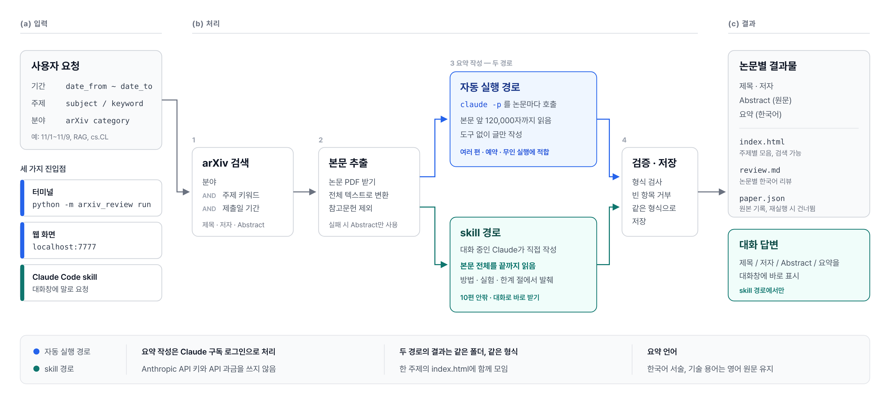

# arxiv-review

arXiv 의 **특정 카테고리 + 특정 주제**만 검색해서, 각 논문의 **한국어 리뷰**를 만들고
검색 가능한 HTML 한 장으로 보여 주는 도구입니다.



리뷰는 Anthropic API 키가 아니라 **Claude Code CLI(`claude`)** 로 만듭니다.
`claude` 에 **Claude Pro 구독 계정**으로 로그인해 두면 사용량이 구독 한도에서 차감되고
API 요금은 나가지 않습니다.

아래 1~4단계를 순서대로 하면 됩니다. 3~4단계는 **웹 화면**(5단계)에서 해도 되고, 두 방식은
같은 설정 파일과 같은 결과 폴더를 씁니다.

---

## 1단계. 설치 (최초 1회)

필요한 것: Python 3.10 이상, Node.js 18 이상

```bash
git clone https://github.com/yongbak/paper-curation.git
cd paper-curation
pip install -r requirements.txt          # truststore(HTTPS 인증서) + PyMuPDF(PDF 본문)
npm install -g @anthropic-ai/claude-code # Claude Code CLI
```

이후 모든 명령은 `paper-curation` 폴더 안에서 실행합니다.

## 2단계. Claude Pro 계정으로 로그인 (최초 1회)

```bash
python -m arxiv_review login
```

1. 브라우저가 열리면 **Claude Pro 구독 계정**으로 로그인하고 승인합니다.
   (브라우저가 안 열리면 터미널에 나온 주소를 직접 열고, 받은 코드를 터미널에 붙여 넣습니다.)
2. 끝나면 로그인 방식이 자동으로 표시됩니다. 언제든 다시 확인하려면:

```bash
python -m arxiv_review status
```

| 표시 | 의미 |
|---|---|
| `Login method:` 에 Claude Pro 계정이 표시되고 "구독 계정으로 로그인돼 있습니다" | 정상. 리뷰가 구독 사용량으로 처리됩니다 |
| "구독으로 확인되지 않습니다" (예: `Claude API account`) | API 과금 계정입니다. `claude auth logout` 후 다시 `login` 하세요 |
| "로그인돼 있지 않습니다" | `python -m arxiv_review login` 을 실행하세요 |

리뷰를 시작하기 전에 도구가 이 확인을 자동으로 하고, 구독 로그인이 아니면 **리뷰를 시작하지 않습니다**.
환경변수 `ANTHROPIC_API_KEY` 가 설정돼 있어도 리뷰 호출에서는 지우므로 API 과금으로 넘어가지 않습니다.

## 3단계. 검색 주제 입력

**`topic add` 명령으로 등록합니다.** 등록한 내용은 `config.json` 파일에 저장됩니다.

```bash
python -m arxiv_review topic add rag \
  --category cs.CL --category cs.IR \
  --keyword "retrieval augmented generation" --keyword "RAG" \
  --exclude survey \
  --days 7 --max 10
```

| 입력 | 뜻 | 예 |
|---|---|---|
| `rag` (첫 단어) | 주제 이름. 영문·숫자·`-`·`_`. 결과 폴더 이름이 됩니다 | `rag`, `llm-agents` |
| `--category` | 검색할 arXiv 카테고리. 여러 번 쓰면 OR · [카테고리 목록](https://arxiv.org/category_taxonomy) | `cs.CL`, `cs.CV`, `q-bio.BM` |
| `--keyword` | **찾을 주제**. 제목·초록에서 구문으로 찾습니다. 여러 번 쓰면 OR. 생략하면 카테고리 전체 | `"diffusion model"` |
| `--exclude` | 제목·초록에 있으면 뺄 단어 | `survey` |
| `--primary-only` | 다른 분야 논문이 cross-list 로 섞이는 것을 막고 primary 카테고리만 | |
| `--days` / `--max` | 최근 N일 제출분 중 최신순 최대 M편 (기본 7일, 10편) | `--days 3 --max 5` |

검색 조건은 **(카테고리 중 하나) AND (키워드 중 하나) AND (기간)** 입니다.
기간은 논문이 arXiv 에 처음 제출된 날짜(v1) 기준이고, 오늘 날짜는 UTC 로 셉니다.
같은 이름으로 다시 `topic add` 하면 준 값만 바뀝니다 (`--category` 는 매번 필요).

```bash
python -m arxiv_review topic list          # 등록된 주제 보기
python -m arxiv_review topic remove rag    # 주제 삭제 (만든 리뷰는 남음)
```

`config.json` 을 직접 편집해도 됩니다. 형식은 `config.example.json` 을 참고하세요.

## 4단계. 실행

```bash
python -m arxiv_review run --topic rag --dry-run   # ① 검색 결과만 확인 (구독 사용량 0)
python -m arxiv_review run --topic rag             # ② 검색 + 한국어 리뷰 + HTML
```

①로 원하는 논문이 잡히는지 보고 키워드를 조정한 뒤 ②를 실행하세요.

**기간 지정**: 기본은 주제에 저장한 `days`(최근 N일)입니다. 날짜를 직접 정하려면:

```bash
python -m arxiv_review run --topic rag --from 2026-11-01 --to 2026-11-09
```

- `--from` / `--to` 는 `YYYY-MM-DD`, 양 끝 날짜를 포함합니다. `--to` 를 빼면 오늘까지입니다.
- 최신순으로 `--max` 편까지만 가져옵니다. 기간 안에 논문이 더 있으면
  "최대 N편에서 잘렸습니다 … 이후 것만 포함" 경고가 나옵니다. 기간 전체가 필요하면 `--max` 를 늘리세요.
- 최근 1~2일 논문은 arXiv 검색 API 에 아직 반영되지 않았을 수 있습니다.
결과는 `output/rag/index.html` 을 브라우저로 열면 됩니다.

| 파일 | 내용 |
|---|---|
| `output/<주제>/index.html` | 그 주제의 모든 리뷰. 검색창, 카드, 펼쳐 보는 전체 리뷰 |
| `output/<주제>/<arxiv_id>/review.md` | 논문별 한국어 리뷰 (마크다운) |
| `output/<주제>/<arxiv_id>/paper.json` | 메타데이터 + 리뷰 원본. 이 파일이 있으면 재실행 때 건너뜀 |

등록 없이 한 번만 검색할 수도 있습니다 (결과는 `output/adhoc/`).

```bash
python -m arxiv_review run --category cs.CV --keyword "diffusion model" --days 3 --max 5
```

그 밖의 `run` 옵션: `--force` 이미 리뷰한 논문도 다시, `--no-fulltext` 초록만으로 리뷰,
`--model opus` 모델 변경, `build --topic rag` 저장된 리뷰로 HTML 만 다시 생성.

## 5단계. 웹 화면으로 쓰기 (선택)

```bash
python -m arxiv_review serve
```

브라우저에서 **http://localhost:7777** 을 엽니다. 종료는 터미널에서 `Ctrl+C`.

1. **분야(arXiv 카테고리)**, **주제 키워드**(한 줄에 하나), **기간**(시작일~종료일), 최대 편수를 입력하고 **검색**
2. 결과마다 제목·저자·Abstract 가 나옵니다. 이미 리뷰한 논문은 한국어 요약과 실험 결과가 함께 나옵니다
3. **이 논문 리뷰** 또는 **아직 리뷰 안 된 논문 모두 리뷰** → 한 편씩 순서대로 리뷰합니다 (보통 편당 30초~2분)
4. 리뷰가 끝나면 **한국어 요약**, **실험 결과** 가 보이고, **전체 리뷰 보기** 로 나머지 항목과 점수를 펼칩니다

- 오른쪽 위 배지가 구독 로그인 상태입니다. 구독 로그인이 아니면 리뷰 버튼이 막히고 해결 방법이 나옵니다.
- **이 조건을 주제로 저장** 은 `topic add` 와 같습니다. 저장한 주제는 터미널의 `--topic` 으로도 쓸 수 있습니다.
- 웹에서 만든 리뷰도 `output/<주제 이름>/` 에 저장되어 터미널 실행 때 건너뜁니다.
- 서버는 이 컴퓨터(127.0.0.1)에서만 접속됩니다. 다른 포트는 `serve --port 8080`.
- 웹 화면은 `serve` 를 실행한 폴더의 `config.json` 과 `output/` 을 씁니다. 터미널 명령과 같은 폴더에서 실행하세요.

## 6단계. Claude Code 에서 말로 시키기 (선택, skill)

이 폴더에서 Claude Code 를 열고 평소 말로 요청하면 됩니다. 명령을 외울 필요가 없습니다.

```bash
cd paper-curation
claude
```

```text
2026-11-01부터 2026-11-09까지 arXiv 논문 중 RAG 관련 논문의 제목/저자/abstract/요약을 만들어줘
```

- 폴더 안의 `.claude/skills/arxiv-review/SKILL.md` 가 자동으로 인식됩니다. 설치할 것은 없습니다.
- Claude 가 주제를 arXiv 카테고리와 키워드로 바꿔 검색하고, 논문마다 **본문 전체**(참고문헌 제외)를
  끝까지 읽은 뒤 요약을 씁니다. 서론이나 초록만 보고 쓰지 않습니다.
- 답변에는 논문별로 **제목 · 저자 · Abstract(원문) · 요약(한국어)** 이 나옵니다.
  전체 내용은 `output/<주제>/index.html` 과 `review.md` 에 저장됩니다.
- 4~5단계(터미널·웹)와 같은 `output/` 폴더, 같은 형식을 씁니다. 이미 만든 논문은 건너뜁니다.
- 지금 대화 중인 Claude 가 직접 쓰므로 `claude -p` 를 따로 띄우지 않습니다.
  사용량은 그 Claude Code 세션의 로그인 계정에서 나갑니다.

| | 4~5단계 (`run`, 웹) | 6단계 (skill) |
|---|---|---|
| 시작 방법 | 명령 또는 버튼 | Claude Code 에 말로 요청 |
| 읽는 분량 | 본문 앞 120,000자까지 | 본문 전체 |
| 맞는 경우 | 여러 편 한꺼번에, 예약·무인 실행 | 10편 안팎, 결과를 대화로 바로 받기 |

논문 한 편이 대화 분량을 많이 차지합니다. 10편이 넘으면 4단계 `run` 이 맞습니다.

---

## 리뷰는 무엇을 읽고 무엇을 쓰나

- **입력**: arXiv PDF 를 받아 참고문헌을 뺀 본문을 최대 120,000자까지 읽습니다 (6단계 skill 은 전체).
  대부분의 논문은 전체가 들어갑니다. 더 길면 앞부분만 읽고, 그 사실을 모델에게 알려
  읽지 않은 부분을 "없다"고 단정하지 않게 합니다. 리뷰 머리말의 **리뷰 근거**에
  본문 전체인지, 일부인지, 초록만인지 표시됩니다.
- **출력**: Abstract(원문) · Essence(한국어 요약) · 알려진 것 · 연구 갭 · 왜 중요한가 · 접근법 · 방법론 ·
  실험 결과(데이터셋·baseline·지표·수치) · 성과 · 독창성 · 한계와 후속 연구 · 평가(5개 항목 1~5점) · 총평.
  서술은 한국어, 기술 용어는 원문 그대로 둡니다.
- **방식**: 원문 문장을 그대로 뽑는 발췌가 아니라, Claude 가 읽고 한국어로 정리한 요약·분석입니다.
  제공된 텍스트에 없는 수치는 쓰지 않도록 지시합니다.

## 구독 사용량

- 논문 1편 = `claude` 호출 1회 (본문 기준 대략 수만 토큰). 한 편씩 순차 처리합니다.
- 기본 모델은 `sonnet` 입니다. Pro 구독의 사용 한도는 claude.ai 채팅과 함께 씁니다.
  처음에는 `--max 3` 정도로 시작하세요.
- 이미 리뷰한 논문은 건너뛰므로 재실행은 새 논문에만 사용량을 씁니다.
- 한도에 걸리면 그 자리에서 멈춥니다. 한도가 풀린 뒤 같은 명령을 다시 실행하면 이어집니다.
- 사용량을 더 줄이려면 `config.json` 의 `review.max_chars` 를 낮추거나 `--no-fulltext` 를 쓰세요.

## 문제 해결

**`CERTIFICATE_VERIFY_FAILED` (인증서 확인 실패)**

arXiv 가 막은 것이 아니라, 이 컴퓨터의 Python 이 HTTPS 인증서를 확인할 목록을 찾지 못한 것입니다.
macOS 의 python.org 설치판, 또는 보안 장비가 HTTPS 를 검사하는 회사·기관 네트워크에서 생깁니다.

```bash
pip install truststore
```

설치하면 운영체제 인증서 저장소(macOS 키체인, Windows 인증서 저장소)를 써서 해결됩니다.
macOS python.org 설치판이면 `/Applications/Python 3.X/Install Certificates.command` 실행으로도 됩니다.
`python -m arxiv_review status` 가 지금 쓰는 인증서 목록과 arXiv 접속 여부를 보여 줍니다.

**"arXiv 가 요청을 잠시 제한했습니다" (HTTP 429)**

arXiv 가 이 인터넷 주소에서 오는 요청을 잠시 막은 것입니다. 안내된 시간만큼 기다린 뒤 다시 검색하세요.
웹 화면의 `503` 은 "arXiv 가 429 를 돌려줬다" 는 것을 이 서버가 브라우저에 전하는 코드입니다.

이 도구 문제인지 네트워크 문제인지는 브라우저 주소창에 아래 주소를 직접 열어 보면 알 수 있습니다.
`Rate exceeded.` 가 보이면 이 도구와 무관하게 지금 네트워크의 인터넷 주소가 arXiv 에 제한된 상태입니다.

```
https://export.arxiv.org/api/query?search_query=cat:cs.AI&max_results=1
```

- 검색 한 번은 보통 arXiv 요청 1번입니다. 도구는 요청 사이 3초 간격을 지킵니다.
- 제한에 걸리면 arXiv 가 알려 준 시간(`Retry-After`) 동안 이 프로그램 전체가 arXiv 에 요청하지 않습니다.
  그 사이 검색하면 기다릴 시간만 알려 줍니다. 대기 중에 요청을 더 보내면 제한이 길어지기 때문입니다.
- 웹 화면은 남은 시간을 검색 버튼에 표시하고, 시간이 지나면 버튼이 다시 켜집니다.
  터미널은 30초·60초 기다리며 최대 3번 시도합니다.
- 10분 안에 같은 조건으로 다시 검색하면 arXiv 에 묻지 않고 받아 둔 결과를 씁니다.
- 회사·기관처럼 여러 사람이 같은 인터넷 주소를 쓰는 네트워크에서는, 내가 검색을 많이 하지 않아도
  다른 사람의 요청이 함께 집계돼 제한에 걸릴 수 있습니다. 이때는 시간을 두고 다시 시도하세요.

## 테스트

```bash
python -m unittest discover -s tests
```
